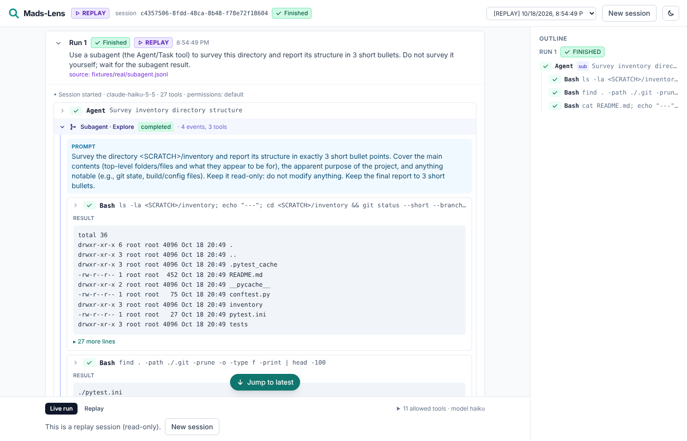

# Assignment 1 — Writeup

I built a basic monitoring system for Claude Code. Right now, it only works when I run Claude directly, not through a plugin. It displays metrics such as **Cost, Duration, Wall Clock Time, Turns, Tokens In/Out, Cache Reads/Writes, and Session Information**.

The goal is to track how much each AI agent run costs and better understand what the agent is doing during execution.

In the Scenario.

Time: Submitted via the Mads-Lens web interface on your Windows machine. This marks the first successful execution following the fix for the `ENOENT` error and the completion of the login process.

Prompt: "What is Assignment 1 about?" — this is quite vague, with no specific instructions on what steps to take.

Working Directory: The course root directory, `Harvard...CS2680` (not the default "scratch" project).

Model: `claude-sonnet-5`. Since `MADS_MODEL` was not explicitly set, the default model was used. There are 40 tools available, and the permission mode is set to "default."

Log Files: `events.jsonl`, `timing.jsonl`, and `meta.json`, located under `data/runs/run_mvivgp0r_aa2c21/`.

Those were successful cases, but along the way, I noticed that Claude sometimes still gets stuck on small details and wastes tokens trying the same approach repeatedly, even when I tell it that something is still not working.

It also seems to get anchored to previous results and treat earlier assumptions as facts, so it takes longer to find the actual bug.

Even after I give it a prompt, Claude sometimes misses features that I thought were part of the requirements, such as the ability to view and manage previous run history.

One thing I would change about Claude Code. I would improve how Claude handles repeated errors.

For example, when Mads-Lens failed with `spawn claude ENOENT` on Windows, the same error happened six times. Claude kept suggesting fixes like reinstalling Claude or restarting PowerShell, but it didn't inspect `claudeProcess.ts` until after the fifth failure.

I think Claude should recognize when the same approach isn't working and try something different. Instead of repeating similar suggestions, it should inspect the relevant code, check the paths, and test its assumptions earlier.